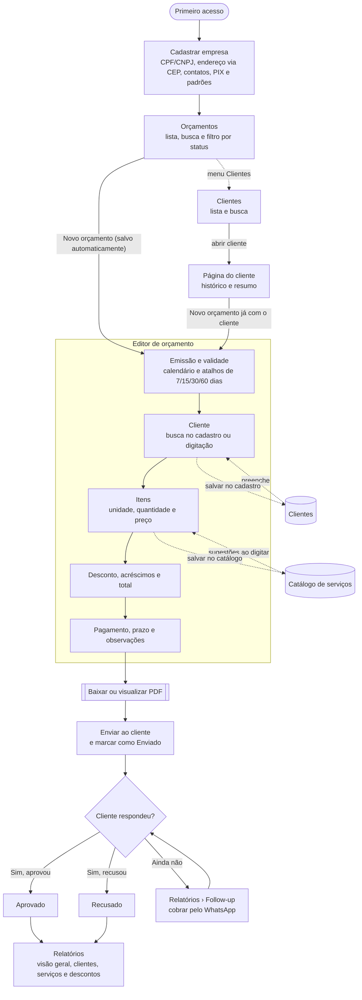
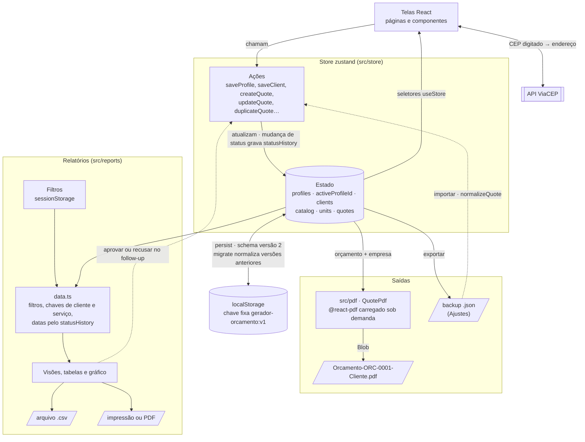

# Orçafácil — gerador de orçamentos de serviços

Ferramenta web para profissionais autônomos criarem orçamentos e exportarem em PDF.
Tudo roda no navegador: não há servidor nem login, e os dados ficam salvos no `localStorage`.

**Use agora, de graça:** <https://murillo-ferrari.github.io/orca-facil/>

Seus dados ficam só no seu navegador. Para levá-los a outro computador, use _Ajustes › Exportar backup_.

## Funcionalidades

- **Perfis de empresa (vários):** CPF ou CNPJ (com máscara e validação), razão social, nome fantasia,
  IE/IM, endereço com preenchimento automático pelo CEP (ViaCEP), contatos, chave PIX e dados bancários.
  Cada perfil tem validade padrão, forma de pagamento e observações padrão, além de numeração própria (`ORC-0001`…).
- **Orçamentos:** itens com unidade configurável, quantidade, preço unitário e total calculado;
  desconto (% ou R$), acréscimos (frete, deslocamento…), forma de pagamento, prazo e observações.
  Salvamento automático, status (rascunho/enviado/aprovado/recusado), duplicar e excluir.
- **Datas:** calendário em pt-BR; validade com atalhos (7/15/30/60 dias) que acompanham a data de emissão.
- **Preenchimento rápido:** `Tab` passa por descrição → unidade → qtd → preço; `Enter` no preço cria o próximo item;
  a descrição sugere itens do catálogo enquanto você digita.
- **Clientes e catálogo de serviços** reutilizáveis, salvos direto do editor.
- **PDF** com layout sóbrio, gerado no navegador (a biblioteca só carrega na hora de gerar), com rodapé e numeração de páginas.
- **Backup:** exporte/importe todos os dados em JSON em _Ajustes_.
- **Página do cliente** com histórico de orçamentos, resumo e taxa de aprovação.
- **Relatórios** (por empresa ou todas), com filtros de período, status, cliente, serviço e faixa de valor,
  exportação em CSV (formato do Excel em português) e impressão/PDF:
  - _Visão geral_: enviados, aprovados, taxa de aprovação, ticket médio, vencidos, tempo até aprovar e evolução mensal.
  - _Follow-up_: orçamentos aguardando resposta (vencidos, vencendo em breve, em aberto), com link de cobrança
    pelo WhatsApp e botões para marcar como aprovado/recusado.
  - _Clientes_: ranking por valor aprovado, taxa de aprovação e último orçamento.
  - _Serviços_: o que mais é orçado e vendido, preço médio praticado vs. preço de catálogo.
  - _Descontos_: quanto foi concedido, em quais orçamentos e para quais clientes.

### Regras dos relatórios

- O período considera a **data de emissão**: os números mostram os orçamentos emitidos no período e o que aconteceu
  com eles. A série "Aprovado" do gráfico e o "fechado no período" usam a **data de aprovação**.
- Taxa de aprovação = aprovados ÷ enviados (tudo que não é rascunho).
- A data de cada mudança de status é registrada no orçamento (`statusHistory`). Orçamentos anteriores a isso usam a
  data de emissão como aproximação.
- Itens adicionados do catálogo guardam o vínculo (`catalogId`); os demais são agrupados pela descrição normalizada
  (sem acentos, maiúsculas e espaços extras).

## Rodando

```bash
git clone https://github.com/murillo-ferrari/orca-facil.git
cd orca-facil
npm install
npm run dev          # desenvolvimento em http://localhost:5173
npm test             # testes automatizados (Vitest); npm run test:watch para modo contínuo
npm run check        # tudo que o CI roda: formatação, lint, tipos e testes
npm run build        # gera o site estático em dist/
```

A edição é escolhida no build pela variável `VITE_EDITION` (padrão `local`; veja `.env.example`). A edição `cloud`
ainda não existe e o build recusa esse valor com uma mensagem explicativa.

O build usa caminhos relativos e rotas com `#`, então a pasta `dist/` funciona em qualquer hospedagem estática
(Netlify, Vercel, GitHub Pages) ou subpasta.

### Publicar a sua própria cópia

1. Faça um _fork_ do repositório.
2. Em _Settings › Pages › Build and deployment_, escolha **GitHub Actions** como _Source_.
3. Cada push na `main` roda as verificações e publica em `https://<seu-usuario>.github.io/<repositorio>/`
   (workflow `.github/workflows/pages.yml`).

## Estrutura

```
orca-facil/
├── README.md
├── LICENSE                     AGPL-3.0
├── CLAUDE.md                   contexto do projeto para o Claude Code (regras, decisões, pendências)
├── package.json                dependências e scripts (dev, build, lint, preview)
├── index.html                  página base (título, descrição, favicon)
├── vite.config.ts              Vite + React + Tailwind; base relativa para hospedar em qualquer pasta
├── tsconfig.json               referências para tsconfig.app.json (código) e tsconfig.node.json (vite.config)
├── .prettierrc                 formatação (Prettier: sem ponto e vírgula, aspas simples, 120 colunas)
├── .oxlintrc.json              lint (oxlint)
├── .gitignore
├── .env.example                variáveis de build (VITE_EDITION)
├── .github/workflows/
│   ├── ci.yml                  formatação, lint, tipos, testes e build a cada push/PR
│   └── pages.yml               publica a edição Local no GitHub Pages a cada push na main
├── public/favicon.svg
├── docs/
│   ├── plano-versao-cloud.md   plano da edição Cloud (login, sincronização entre dispositivos, planos)
│   └── avaliacao-autenticacao-e-backend.md  Clerk × Supabase Auth e alternativas de backend
└── src/
    ├── main.tsx                ponto de entrada (carrega a fonte Inter, servida pelo próprio app)
    ├── vite-env.d.ts           tipos das variáveis de ambiente (VITE_EDITION)
    ├── App.tsx                 layout (menu lateral, barra inferior no celular, seletor de empresa) e rotas
    ├── index.css               Tailwind, tema (cores) e estilos de calendário e impressão
    ├── types.ts                modelos: empresa, cliente, catálogo, unidade, orçamento, item, histórico de status
    │
    ├── data/                   formato dos dados, independente de onde ficam guardados
    │   ├── schema.ts           DataState, chave do localStorage, versão do formato e migrações
    │   ├── backup.ts           criar e ler o arquivo de backup (JSON)
    │   └── persistence.ts      contrato de persistência que cada edição implementa
    │
    ├── editions/               o que muda entre as edições
    │   ├── index.ts            edição atual (VITE_EDITION) e sua persistência
    │   └── local/persistence.ts  edição Local: localStorage
    │
    ├── store/
    │   ├── store.ts            estado global (zustand) e ações; a persistência vem de src/editions
    │   └── factories.ts        criação de registros vazios, unidades padrão, numeração e normalização de dados antigos
    │
    ├── lib/
    │   ├── format.ts           moeda, datas, máscaras e validação de CPF/CNPJ, CEP e telefone
    │   ├── calc.ts             total do item, subtotal, desconto, acréscimos e total do orçamento
    │   ├── cep.ts              consulta de endereço na API ViaCEP
    │   ├── clientQuotes.ts     regra de quais orçamentos pertencem a um cliente
    │   └── status.ts           rótulos e cores dos status
    │
    ├── components/
    │   ├── ui.tsx              base: botão, campos, card, modal, abas segmentadas, estado vazio
    │   ├── toast.tsx           notificações
    │   ├── DateField.tsx       campo de data com calendário em pt-BR
    │   ├── NumberInput.tsx     número/moeda no formato brasileiro
    │   ├── DocumentField.tsx   CPF/CNPJ com alternância, máscara e validação
    │   ├── AddressFields.tsx   endereço com preenchimento pelo CEP
    │   ├── ClientFields.tsx    campos de cliente (usados no cadastro e no orçamento)
    │   ├── ClientFormModal.tsx modal de cadastro/edição de cliente
    │   ├── ItemsEditor.tsx     itens do orçamento: sugestões do catálogo, atalhos de teclado, menu do item
    │   ├── UnitSelect.tsx      seletor de unidade (mostra só a sigla quando fechado)
    │   └── QuoteRow.tsx        linha de orçamento nas listas (PDF, duplicar, excluir)
    │
    ├── pages/                  telas (rota entre parênteses)
    │   ├── QuotesList.tsx      lista de orçamentos e boas-vindas  (/)
    │   ├── QuoteEditor.tsx     editor de orçamento                (/orcamentos/:id)
    │   ├── Clients.tsx         lista de clientes                  (/clientes)
    │   ├── ClientDetail.tsx    página do cliente com histórico    (/clientes/:id)
    │   ├── Catalog.tsx         catálogo de serviços               (/servicos)
    │   ├── Reports.tsx         relatórios, abas e filtros         (/relatorios e /relatorios/:tab)
    │   ├── Profiles.tsx        perfis de empresa                  (/empresas)
    │   ├── ProfileEditor.tsx   cadastro/edição de empresa         (/empresas/:id)
    │   └── Settings.tsx        unidades e backup                  (/config)
    │
    ├── pdf/
    │   ├── QuotePdf.tsx        layout do PDF do orçamento (@react-pdf/renderer)
    │   └── exportPdf.ts        geração sob demanda, nome do arquivo e download
    │
    └── reports/
        ├── data.ts             cálculos: filtros, períodos, agrupamento de clientes/serviços, datas pelo histórico
        ├── FilterBar.tsx       barra de filtros (recolhível no celular) e resumo dos filtros para impressão
        ├── OverviewView.tsx    Visão geral
        ├── FollowUpView.tsx    Follow-up (cobrança pelo WhatsApp, marcar aprovado/recusado)
        ├── TableViews.tsx      Clientes, Serviços e Descontos
        ├── DataTable.tsx       tabela ordenável que também gera o CSV
        ├── MonthlyChart.tsx    gráfico mensal orçado × aprovado (SVG)
        ├── csv.ts              CSV no formato do Excel em português
        └── shared.tsx          cards de indicador, seções e botão de exportar
```

Os testes (`*.test.ts`) ficam ao lado do código que testam: `lib/`, `data/`, `store/`, `reports/`, `pdf/` e
`components/NumberInput`.

## Como funciona

### Funcionamento do app

O caminho do profissional: cadastra a empresa uma vez, monta o orçamento, gera o PDF e acompanha a resposta do cliente
até o orçamento virar aprovado ou recusado. Clientes e serviços salvos alimentam os próximos orçamentos.



### Fluxo dos dados

Não há servidor: as telas leem e alteram um único estado global (zustand), que é persistido no `localStorage`
pela persistência da edição (`src/editions`). Os dados dos orçamentos nunca saem do navegador, e a fonte é servida
pelo próprio app. Há só dois contatos com serviços externos:

- **ViaCEP:** recebe apenas o CEP digitado, para preencher o endereço.
- **WhatsApp:** só quando o usuário clica em _Cobrar_ no follow-up; o link leva o telefone, o primeiro nome do
  cliente e o número do orçamento.



> **Chave × versão:** o `:v1` em `gerador-orcamento:v1` é só o nome da chave no `localStorage` e não deve mudar
> (renomear apagaria os dados de quem já usa o app). A versão do formato dos dados é o `version` do `persist`
> (hoje `2`). Para mudar o formato, aumente `version` e trate a conversão em `migrate` / `normalizeQuote`, que rodam
> para qualquer versão anterior, inclusive dados sem versão.

## Notas sobre o PDF (@react-pdf/renderer)

Algumas armadilhas da biblioteca, já tratadas em `src/pdf/QuotePdf.tsx`:

- `lineHeight` não pode ficar na `Page` nem em `View`s; use-o apenas em estilos de `Text` que também definem `fontSize`.
- `Text` com `render` (numeração de páginas) precisa de `left` + `right` e de um conteúdo inicial (`' '`).
- `View` absoluta e `fixed` precisa de `height`; `Text` absoluto não pode ter `height`.

## Como contribuir

Sugestões e correções são bem-vindas.

- **Encontrou um problema ou tem uma ideia?** Abra uma
  [issue](https://github.com/murillo-ferrari/orca-facil/issues) descrevendo o que aconteceu (ou o que gostaria) e,
  se possível, os passos para reproduzir.
- **Quer enviar código?** Faça um _fork_, crie uma branch e abra um _pull request_. Antes, rode `npm run check`
  (o mesmo que o CI roda) e inclua testes para regras novas.
- **Convenções:** interface, comentários e documentação em português do Brasil, com acentuação; nomes no código em
  inglês. Formatação pelo Prettier (`npm run format`). O `CLAUDE.md` resume as regras de negócio e as decisões do
  projeto.

## Licença

[GNU AGPL-3.0](LICENSE). Você pode usar, estudar, modificar e redistribuir o código. Se disponibilizar uma versão
modificada para outras pessoas usarem pela rede (por exemplo, hospedando-a como serviço), precisa publicar o código
dessa versão sob a mesma licença.
