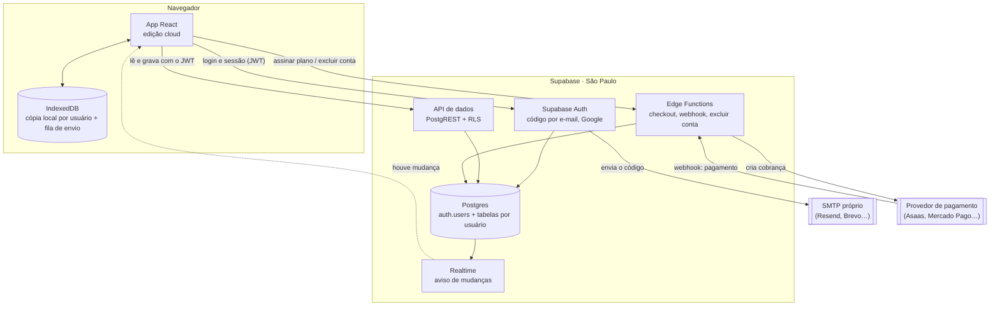
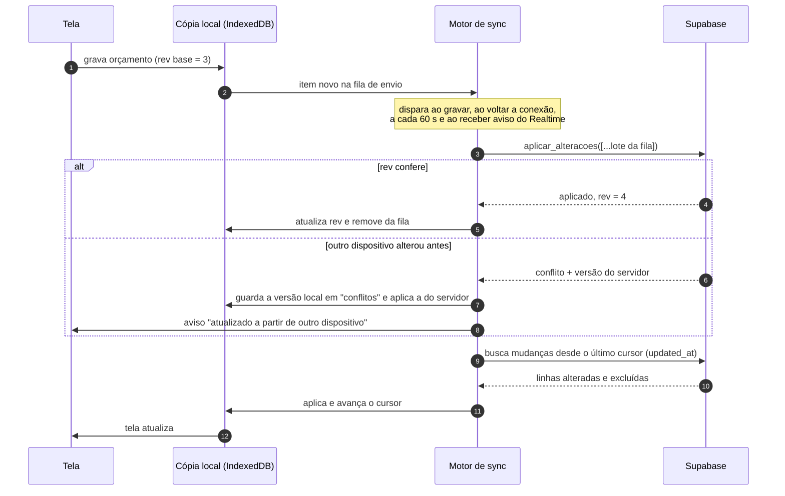
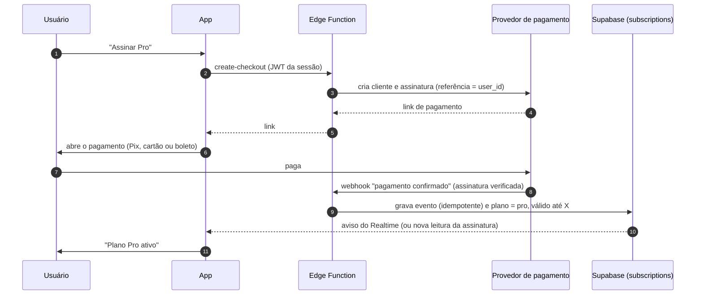

# Plano de implementação — Orçafácil Cloud

> Documento de planejamento, atualizado em 26/11/2026. Estado: **F1 a F7 concluídas** (edição Local publicada; edição Cloud
> com login, sincronização, plano Pro pelo Mercado Pago e landing, rodando no projeto `staging`). Faltam F8 a F10.
> Valores de preços e limites de terceiros foram verificados em novembro de 2026 e devem ser reconferidos antes de
> contratar (fontes no fim do documento).

> **Decidido:** backend **Supabase** e autenticação **Supabase Auth**. O Clerk foi descartado porque a cobrança dele
> (Clerk Billing) não funciona no Brasil, e sem ela não compensava um segundo fornecedor. Comparativo e justificativa
> em [avaliação de autenticação e backend](avaliacao-autenticacao-e-backend.md).

## 1. Objetivo

O projeto passa a ter duas edições, a partir do **mesmo código**:

| | **Edição Local** (etapa 1) | **Edição Cloud** (etapa 2) |
|---|---|---|
| Onde roda | GitHub Pages, ou onde a pessoa quiser (clone + build) | Domínio próprio (`orcafacil.murilloferrari.tech`) |
| Conta | Não precisa | Login obrigatório (Supabase Auth) |
| Dados | `localStorage` do navegador | Banco na nuvem (Supabase/Postgres) + cópia local para uso offline |
| Diferencial | Grátis, código aberto, privado por padrão | Mesmos dados em qualquer dispositivo; backup automático |
| Custo para o usuário | Grátis | Plano Pago (Pro), único na nuvem |

A edição Local continua existindo e completa. A Cloud acrescenta conta, sincronização e planos, e não pode piorar
a experiência atual: o app continua rápido e funciona sem internet.

## 2. Decisões que dependem de você

Decididas em 18/11/2026: **D1, D2 e D3**, além de backend e autenticação (Supabase + Supabase Auth). D4, D5, D6, D7, D8 e D10
foram decididas durante a F4–F7. Pendente: D9 (nome).

| # | Decisão | Opções | Recomendação |
|---|---|---|---|
| D1 | **Licença** do repositório público | MIT · AGPL-3.0 | ✅ **AGPL-3.0** — quem hospedar uma versão modificada do app como serviço precisa publicar o código |
| D2 | **Código da Cloud** no mesmo repositório público? | Mesmo repo · repo privado separado | ✅ **Mesmo repositório**, com as edições escolhidas por variável de build; segredos fora do código |
| D3 | **Domínio** | — | ✅ **`orcafacil.murilloferrari.tech`** (subdomínio no Cloudflare; trocado em 23/11/2026 no lugar de `orcafacil.com.br`). App nesse endereço, e-mails de login de `login@orcafacil.murilloferrari.tech` |
| D4 | **Provedor de pagamento** | Asaas · Mercado Pago · Stripe · Paddle (detalhes na seção 9.2) | ✅ **Mercado Pago** (assinaturas _preapproval_; decidido em 24/11/2026) |
| D5 | **Planos** | Ver seção 9.1 | ✅ **Só o Pro existe na nuvem: R$ 9,99/mês ou R$ 99,99/ano**. O grátis é a edição Local, no aparelho (24 e 26/11/2026) |
| D6 | **Formas de login** | E-mail com código · Google · Apple · senha | ✅ **E-mail com código de 6 dígitos + Google** (feito na F4) |
| D10 | **Serviço de envio de e-mail (SMTP)** | Resend · Brevo · Amazon SES · Postmark · ZeptoMail | ✅ **Resend** (decidido em 23/11/2026) |
| D7 | **Nível de offline** | Só online · leitura offline · leitura e escrita offline | ✅ **Leitura e escrita offline** (feito na F5) |
| D8 | **Conflito** entre dispositivos | Última gravação vence · diálogo de escolha · mesclar | ✅ **Mescla em três vias** com diff lado a lado; vale a nuvem até a pessoa decidir (seção 7.5, decidido em 24/11/2026) |
| D9 | **Nome do produto** | — | **Orçafácil**, acompanhando o domínio; confirmar quando o registro for concluído |

## 3. Etapa 1 — Publicação da edição Local (pré-requisito)

Rápida e independente. Dá visibilidade ao projeto antes da Cloud.

### 3.1 Antes de tornar o repositório público

- [x] **E-mail nos commits** (decidido: manter o e-mail pessoal): o e-mail configurado no Git aparece no histórico de um repositório público. Confira
      com `git log --format='%an <%ae>' | sort -u`. Se não quiser expô-lo, configure o e-mail _noreply_ do GitHub
      (`usuario@users.noreply.github.com`) e reescreva o histórico **antes** do primeiro push (são poucos commits).
- [x] Conferir que não há segredos no histórico (não há nenhum).
- [x] Adicionar `LICENSE` (AGPL-3.0) e uma seção "Como contribuir" no README.
- [x] Hospedar a fonte Inter localmente (pacote `@fontsource-variable/inter`) e remover o Google Fonts do
      `index.html` (feito na F1). Assim o app não contata terceiros ao abrir, o que fica coerente com a promessa de privacidade.
- [x] Ajustar o README: link para a versão publicada e instruções de clone/build/deploy.

### 3.2 Publicação

1. Criar o repositório no GitHub (público) e fazer o push da `main`.
2. Em _Settings › Pages_, escolher **GitHub Actions** como origem.
3. Workflow `.github/workflows/pages.yml`: em cada push na `main`, roda lint, tipos, testes e build
   (`VITE_EDITION=local`), e publica `dist/` com `actions/deploy-pages`.
4. O app já funciona em subpasta (`base: './'` e `HashRouter`), então a URL fica
   `https://<usuario>.github.io/<repositorio>/`.

### 3.3 Critérios de aceite

- A URL pública abre o app, cria orçamentos e gera PDF.
- Um clone limpo roda com `npm install && npm run dev`.
- O build do Pages não contém nenhum código da Cloud (Supabase), o que se confere pelo tamanho do bundle.

## 4. Arquitetura da Cloud

### 4.1 Visão geral



### 4.2 Componentes e responsabilidades

| Componente | Responsabilidade | Plano |
|---|---|---|
| **Supabase Auth** | Cadastro e login (código de 6 dígitos por e-mail, Google), sessão com renovação automática, CAPTCHA no envio do código. Usuários ficam em `auth.users`, no mesmo banco | 50.000 MAU no Free, 100.000 no Pro |
| **Supabase Postgres** | Dados de cada usuário, isolados por RLS (`user_id = auth.uid()`) | Free no desenvolvimento; **Pro (US$ 25/mês) em produção** (o Free pausa após 7 dias sem uso) |
| **Supabase Edge Functions** | Checkout e webhook do pagamento, exclusão de conta. Únicos lugares com chaves secretas | Incluso |
| **Supabase Realtime** | Avisar os outros dispositivos de que há mudanças (eles então sincronizam) | Incluso |
| **SMTP próprio** | Entregar os e-mails de login. O envio padrão do Supabase só atende membros da equipe e manda 2 e-mails/hora | Plano grátis do provedor (conferir) |
| **Provedor de pagamento** | Assinatura recorrente em reais (Pix, cartão, boleto) | Taxa por transação |
| **Cloudflare Pages** | Hospedagem do app Cloud no domínio próprio, com cabeçalhos de segurança (CSP) | Free |
| **Sentry** (opcional) | Erros em produção | Free |

**Por que tudo no Supabase:** um único fornecedor para identidade, dados, tempo real e funções. Tudo fica na região
São Paulo, o que inclui os dados de conta e simplifica a LGPD. As regras de acesso usam `auth.uid()` com chave
estrangeira para `auth.users`, então excluir a conta apaga os dados em cascata. Postgres padrão também é portável e
pode ser auto-hospedado, coerente com o repositório aberto. O Clerk e outros serviços de autenticação, além de
Firebase, InstantDB, Convex e PocketBase, foram avaliados em
[avaliacao-autenticacao-e-backend.md](avaliacao-autenticacao-e-backend.md). O **PowerSync** fica como plano B para a
sincronização offline, por cima do mesmo banco.

### 4.3 Uma base de código, duas edições

A edição é escolhida no build pela variável `VITE_EDITION=local|cloud`. O código da Cloud é carregado com
`import()` dinâmico atrás dessa variável, então o bundle Local não carrega o Supabase.

```
src/
  data/                     contrato de dados usado pelas telas (não muda entre edições)
    repository.ts           interface: ler/gravar perfis, clientes, catálogo, unidades, orçamentos
  editions/
    local/                  implementação atual (zustand + localStorage), sem mudanças de comportamento
    cloud/
      auth/                 telas de login (e-mail → código, Google), callback OAuth, guarda de rotas, sessão
      sync/                 cache IndexedDB, fila de envio, pull/push, conflitos, numeração
      billing/              tela de planos, limites, checkout
      supabase.ts           cliente Supabase (sessão do Supabase Auth)
supabase/
  migrations/               SQL versionado (tabelas, RLS, funções)
  functions/                create-checkout, billing-webhook, delete-account
  templates/                modelos de e-mail de login em pt-BR
  tests/                    testes de RLS (pgTAP)
e2e/                        testes Playwright (inclusive dois "dispositivos" sincronizando)
.github/workflows/          ci.yml, pages.yml (Local), cloud.yml (Cloud + migrações)
```

**Rotas:** a edição Local mantém `HashRouter` (necessário no GitHub Pages). A Cloud usa rotas por caminho
(`BrowserRouter`): o retorno do login com Google chega em `/auth/callback?code=…` (fluxo PKCE), o que conflitaria com
rotas por `#`. O Cloudflare Pages redireciona tudo para o `index.html` (`_redirects`).

**Estado na tela:** as telas continuam usando o store zustand. Na Cloud, o store deixa de persistir no
`localStorage` e passa a ser alimentado pelo motor de sincronização (seção 7). As telas não sabem de onde vêm os
dados.

## 5. Modelo de dados no Postgres

### 5.1 Estratégia: colunas de controle + documento JSON

Cada entidade vira uma tabela com:

- **colunas usadas pelo servidor** (dono, chaves, datas, status, número), para RLS, índices, limites e unicidade;
- **`data jsonb`** com o objeto completo, exatamente no formato dos tipos de `src/types.ts`.

Motivo: todos os cálculos (totais, relatórios, PDF) já rodam no navegador. Normalizar itens e acréscimos em tabelas
separadas daria trabalho de mapeamento sem benefício agora. Se um dia houver relatórios no servidor, as colunas
extraídas resolvem, e uma view pode expandir o JSON.

| Tabela | Colunas extraídas além do padrão | Observações |
|---|---|---|
| `user_settings` | — | 1 linha por usuário: unidades, preferências |
| `company_profiles` | `next_number int` | `next_number` é a fonte da verdade da numeração (seção 7.6). Nome evita confusão com "perfil de usuário" |
| `clients` | `name text`, `document_digits text` | |
| `catalog_items` | `description text` | |
| `quotes` | `profile_id uuid`, `number text`, `status text`, `issue_date date` | Itens, acréscimos, cliente e `statusHistory` ficam no `data` |
| `plan_prices` | `billing_interval`, `amount`, `months` | Preços do Pro (mensal e anual), lidos pela função de assinatura e pela landing. (`plan_limits` existiu até 26/11/2026, quando os limites do grátis foram removidos) |
| `subscriptions` | `plan`, `status`, `current_period_end`, `provider`, `provider_customer_id`, `provider_subscription_id` | Gravada **só** pelo servidor (gatilho de cadastro e Edge Functions) |
| `billing_events` | `provider`, `event_id` (único), `payload jsonb` | Idempotência e auditoria dos webhooks |

`activeProfileId` (empresa ativa) é preferência de cada dispositivo e fica só no local. As unidades vão para o
`user_settings.data`.

Colunas padrão de toda tabela sincronizada: `id uuid` (gerado no cliente), `user_id uuid` (de `auth.uid()`, com
chave estrangeira para `auth.users` e `on delete cascade`),
`rev int` (versão da linha), `updated_at timestamptz` (relógio do servidor), `deleted_at timestamptz`
(exclusão lógica, para os outros dispositivos saberem que algo foi apagado).

### 5.2 Esboço de SQL (migração inicial)

> Esboço de planejamento. A implementação real (F3) está em `supabase/migrations/` e difere em detalhes: tabela
> `company_profiles`, funções auxiliares no schema `private` e policies de INSERT com `private.can_create_quote()`.

```sql
-- Mantém rev/updated_at sob controle do servidor e impede trocar o dono da linha
create function public.touch_row() returns trigger language plpgsql as $$
begin
  if tg_op = 'UPDATE' then
    new.user_id := old.user_id;
    new.rev := old.rev + 1;
  end if;
  new.updated_at := clock_timestamp();
  return new;
end $$;

create table public.quotes (
  id          uuid primary key,
  user_id     uuid not null default auth.uid() references auth.users (id) on delete cascade,
  profile_id  uuid not null,
  number      text not null,
  status      text not null check (status in ('rascunho','enviado','aprovado','recusado')),
  issue_date  date not null,
  data        jsonb not null check (pg_column_size(data) < 262144), -- 256 KB por orçamento
  rev         int not null default 1,
  updated_at  timestamptz not null default clock_timestamp(),
  deleted_at  timestamptz
);
create index quotes_sync_idx on public.quotes (user_id, updated_at);
create unique index quotes_number_uq on public.quotes (user_id, profile_id, number) where deleted_at is null;
create trigger quotes_touch before insert or update on public.quotes
  for each row execute function public.touch_row();

alter table public.quotes enable row level security;

create policy "dono lê" on public.quotes for select to authenticated
  using ((select auth.uid()) = user_id);
create policy "dono cria (respeitando o plano)" on public.quotes for insert to authenticated
  with check ((select auth.uid()) = user_id and private.can_create_quote());
create policy "dono altera" on public.quotes for update to authenticated
  using ((select auth.uid()) = user_id)
  with check ((select auth.uid()) = user_id);
-- Sem policy de DELETE: excluir = preencher deleted_at. Linhas excluídas há mais de 90 dias são
-- removidas por um job (pg_cron). A exclusão da conta apaga tudo pelo "on delete cascade".

-- Dados iniciais de cada novo usuário (substitui o webhook de cadastro)
create function public.handle_new_user() returns trigger
  language plpgsql security definer set search_path = '' as $$
begin
  insert into public.user_settings (user_id, data) values (new.id, '{}'::jsonb); -- unidades padrão aplicadas pelo app
  insert into public.subscriptions (user_id, plan, status) values (new.id, 'free', 'active');
  return new;
end $$;
create trigger on_auth_user_created after insert on auth.users
  for each row execute function public.handle_new_user();
```

As demais tabelas seguem o mesmo molde. A tabela `subscriptions` tem só policy de **leitura** para o dono. Escrita
apenas com a chave de serviço, dentro das Edge Functions.

### 5.3 Funções no banco (RPC)

Implementadas na F3 (`supabase/migrations/`). As chamáveis pelo app rodam como o usuário (RLS vale); as auxiliares
ficam no schema `private`, que a API não expõe.

| Função | Para quê |
|---|---|
| `aplicar_alteracoes(p_changes)` | Recebe um lote (até 500) da fila de envio: `{ table, id, data, base_rev, deleted }`. Cria se `base_rev` for nulo; altera **somente se** `rev` ainda for igual a `base_rev`; `deleted` faz/desfaz a exclusão lógica. Cada item é independente e volta em `applied` (com o novo `rev`), `conflicts` (com a linha atual do servidor) ou `rejected` (com o motivo: `limite_do_plano`, `dados_invalidos`, `duplicado`, `sem_permissao`) |
| `buscar_alteracoes(p_desde, p_limite)` | Por tabela, até `p_limite` linhas alteradas depois de `p_desde` (inclui excluídas), mais `has_more` e `server_time` |
| `reservar_numeros_orcamento(p_empresa, p_quantidade)` | Atômica: devolve o primeiro número de um bloco reservado. Testada com 100 reservas simultâneas, sem colisão |
| `definir_proximo_numero(p_empresa, p_proximo)` | Campo "Próximo número" da tela de empresa |
| `uso_do_plano()` | Plano em vigor, orçamentos criados no mês, empresas e os limites |
| `private.current_plan()`, `private.can_create_quote()`, `private.can_create_company_profile()` | Usadas nas policies de INSERT. O mês é contado no fuso de São Paulo, e excluídos contam (apagar não devolve cota) |
| `private.handle_new_user()` | Gatilho no cadastro: cria `user_settings` e a assinatura (`plan = 'free'`, que significa "sem plano") |
| `private.purge_deleted_rows()` | Remove de vez linhas excluídas há mais de 90 dias (pg_cron, diário) |

Proteções feitas por gatilho: o servidor define `user_id` (sem o app enviar), `rev`, `inserted_at` e `updated_at`;
`data.id` precisa ser igual ao `id` da linha; colunas de orçamento são extraídas do documento; `next_number` só muda
pelas funções de numeração, e `data.nextNumber` sempre reflete o valor real.

### 5.4 Testes do banco

78 testes pgTAP em `supabase/tests/database/` (`npm run db:test`, também no CI):

- **isolamento:** um usuário não lê, não altera, não "adota" nem apaga linhas de outro; visitante sem login não acessa
  nada; excluir a conta apaga tudo em cascata; todas as tabelas têm RLS;
- **integridade:** versão sobe e não pode ser forjada; colunas extraídas; validações (status, data, número repetido);
  numeração protegida;
- **planos:** sem Pro a conta só lê (nenhuma tabela grava), Pro sem limites, tolerância de 7 dias na
  inadimplência, cancelada vale até o fim do período, nada é apagado ao ficar sem plano;
- **sincronização:** criação, alteração, conflito, exclusão/restauração, lotes com itens inválidos, paginação da busca
  e numeração.

Os testes foram validados por sabotagem: desligar a RLS, remover o limite do plano ou quebrar o controle de versão
faz os testes correspondentes falharem.

## 6. Autenticação (Supabase Auth)

### 6.1 Telas e fluxos

| Rota | Conteúdo |
|---|---|
| `/entrar` | Campo de e-mail + botão "Continuar com Google". Envia o código e vai para a etapa do código |
| `/entrar` (etapa 2) | Campo de 6 dígitos (cola automática do código, `inputmode="numeric"`, reenvio liberado após 60 s) |
| `/auth/callback` | Retorno do Google: troca o `code` pela sessão (PKCE) e redireciona ao app |
| `/conta` | E-mail, contas vinculadas, "Sair", "Sair e apagar dados deste dispositivo", "Exportar dados", "Excluir conta" |

Não há tela separada de cadastro. O primeiro código enviado a um e-mail novo cria a conta
(`shouldCreateUser: true`), e o gatilho `handle_new_user` prepara os dados iniciais. Todas as outras rotas exigem
sessão.

```ts
// Envio do código e verificação
await supabase.auth.signInWithOtp({ email, options: { shouldCreateUser: true, captchaToken } })
await supabase.auth.verifyOtp({ email, token: codigo, type: 'email' })

// Google
await supabase.auth.signInWithOAuth({ provider: 'google', options: { redirectTo: `${origin}/auth/callback` } })
```

### 6.2 Configuração

> **Antes de implementar as telas**, consultar o Modern Web Guidance (`npm run -s mwg -- search ...`), em especial
> os guias de formulários e de passkeys: campo de código com `autocomplete="one-time-code"` e `inputmode="numeric"`,
> e-mail com `autocomplete="email webauthn"` (deixa o caminho pronto para passkeys no futuro), mensagens de erro
> anunciadas a leitores de tela e o fluxo de passkeys (`passkey-registration`, `passkey-authentication`) como
> evolução do login por código.

- **Cliente:** `createClient(VITE_SUPABASE_URL, VITE_SUPABASE_PUBLISHABLE_KEY, { auth: { flowType: 'pkce' } })`.
  O supabase-js guarda e renova a sessão sozinho; o mesmo cliente é usado pelo motor de sincronização.
- **E-mail com código:** já vem ativo. O modelo do e-mail "Magic Link" passa a mostrar o código (`{{ .Token }}`), em
  pt-BR, com o nome do produto (`supabase/templates/`). O código vale 1 hora (configurável) e pode ser pedido 1 vez
  por minuto por usuário.
- **SMTP próprio (obrigatório):** o envio padrão do Supabase só entrega para membros da equipe e é limitado a
  2 e-mails/hora. Com SMTP próprio, o limite padrão é 30 e-mails/hora, ajustável em _Rate Limits_. Configurar
  SPF, DKIM e DMARC no domínio remetente (`login@orcafacil.murilloferrari.tech`).
- **Google:** criar o cliente OAuth no Google Cloud (tela de consentimento com nome, logo e política de privacidade)
  e cadastrar as URLs de retorno em _Authentication › URL Configuration_ (produção, staging e localhost).
- **CAPTCHA:** Cloudflare Turnstile no envio do código, para evitar abuso do SMTP.
- **Duração da sessão:** padrão do Supabase (token curto com renovação automática), adequado para o celular ficar
  conectado.

### 6.3 Conta

- **Sair:** `supabase.auth.signOut()` mantém a cópia local (separada por usuário). "Sair e apagar dados deste
  dispositivo" também limpa o IndexedDB, para computadores compartilhados.
- **Excluir conta:** Edge Function `delete-account`. Ela confirma a sessão, cancela a assinatura no provedor de
  pagamento e chama `auth.admin.deleteUser(uid)`. O `on delete cascade` apaga todas as tabelas do usuário.
- **Plano na interface:** lido da tabela `subscriptions`. Se for útil ter o plano no próprio token, um
  _Custom Access Token Hook_ pode incluir a claim `plan`, apenas para a interface. A segurança continua no banco.

## 7. Sincronização entre dispositivos

O coração da etapa: é o que entrega o diferencial "meus dados em qualquer dispositivo" sem perder a rapidez e o uso
offline.

### 7.1 Princípios

1. **Local primeiro:** a tela sempre lê e grava na cópia local (IndexedDB) e responde na hora.
2. **Fila de envio (outbox):** toda gravação entra numa fila persistente e é enviada quando houver conexão.
3. **Pull incremental:** cada dispositivo busca só o que mudou desde a última sincronização.
4. **Idempotência:** reenviar a mesma alteração não causa efeito duplicado (o `id` vem do cliente e o `rev` é
   conferido).

### 7.2 Cópia local

- IndexedDB (biblioteca `idb`), um banco **por usuário** (`orcafacil:<userId>`), com os stores `profiles`,
  `clients`, `catalog_items`, `quotes`, `settings`, `outbox`, `meta` (cursores de sync) e `conflicts`.
- Motivo para não usar o `localStorage`: o limite de cerca de 5 MB e a gravação síncrona travam com históricos
  grandes. O IndexedDB aguenta centenas de MB.
- Na abertura do app, o store zustand é carregado do IndexedDB. Depois, toda ação do store grava no IndexedDB e na
  outbox.

### 7.3 Ciclo de sincronização



### 7.4 Pull incremental

- Por tabela: `select … where updated_at > :cursor - interval '10 seconds' order by updated_at limit 500`.
- A janela de 10 s cobre transações confirmadas fora de ordem. Como a aplicação é idempotente (compara `rev`), ler
  a mesma linha duas vezes não tem efeito.
- Linhas com `deleted_at` removem o registro da cópia local.
- O Realtime (`postgres_changes` filtrado por `user_id`) só **avisa** que há novidade. Os dados vêm pelo pull, o
  que mantém um único caminho de leitura e tolera mensagens perdidas.

### 7.5 Conflitos (decisão D8)

- Unidade de conflito: o **registro inteiro** (um orçamento, um cliente).
- A versão do servidor vale até a pessoa decidir. A versão local, a da nuvem e a base ficam no store `conflicts`.
- **Resolução pela pessoa (decidido em 24/11/2026, no lugar de "versões substituídas"):** o conflito vira uma tela de
  mescla no estilo dos editores de código (_Ajustes › Conflitos de sincronização_). Cada campo em que os dois lados
  mudaram de forma diferente aparece em **diff lado a lado** (jsdiff): nuvem à esquerda em vermelho, sua versão à direita
  em verde, palavras alteradas em destaque, e a pessoa escolhe um lado por campo. A mescla é em **três vias**
  (versão-base × sua × nuvem): o que só um lado mudou não pergunta, e conflitos de campos diferentes se resolvem
  sozinhos. Enquanto não houver decisão, vale a versão da nuvem. Sem decisão, o aviso some em 30 dias. Cobre também
  "excluí aqui, editaram lá" e o inverso (a escolha de manter recria o item).
- **Decidido (23/11/2026): fora da F5.** Nesta fase, todo conflito de orçamento segue "prevalece o servidor" e a
  versão local vai para _Versões substituídas_. A união de `statusHistory` fica para depois.

### 7.6 Numeração de orçamentos com vários dispositivos

O problema: dois dispositivos offline criariam o mesmo `ORC-0042`.

A solução é a **reserva de blocos por dispositivo**:

1. Online, cada dispositivo reserva um bloco pequeno (ex.: 3 números) por empresa, via `reservar_numeros_orcamento`.
2. Novos orçamentos usam o próximo número do bloco local, mesmo offline.
3. Quando o bloco acaba, reserva outro, se houver conexão.
4. Offline e sem números sobrando, o orçamento é criado com número provisório ("definido ao sincronizar"). O PDF
   fica bloqueado até a sincronização, porque não pode sair um PDF com número que vá mudar.

Consequência aceitável: podem surgir **saltos** na numeração (números reservados e não usados). Orçamento não é
documento fiscal, então não exige sequência sem lacunas. Isso deve ser explicado na tela de empresa.

O campo "Próximo número" da empresa passa a ser alterado por RPC. O índice único `(user_id, profile_id, number)`
impede duplicidade.

### 7.6.1 Fila e sincronização na F5 (decidido em 23/11/2026)

- **Captura por diferença:** um módulo compara o store com a última versão sincronizada, por `id`, e enfileira
  só o que mudou. As ações do store não mudam.
- **Uma entrada por registro na fila:** várias edições offline do mesmo registro viram uma entrada com o último
  estado e o `base_rev` original. Sem isso, o dispositivo entraria em conflito consigo mesmo.
- **Lotes de até 50** pelo `aplicar_alteracoes`. `applied` remove da fila; `conflicts` vai para o store
  `conflicts`; `rejected` fica marcado com o motivo e não é reenviado em loop.
- **Pull** pelo `buscar_alteracoes`, com cursor por tabela (`updated_at` menos 10 s) e repetição enquanto
  `has_more`.
- **Quando sincroniza:** ao gravar (com atraso de 1 s), ao voltar a conexão, ao voltar para a aba e a cada 60 s.
  Realtime fica para depois (decidido).
- **Armazenamento (como ficou):** IndexedDB nativo, banco `orcafacil:<userId>` com um store chave-valor:
  `known:<tabela>` (rev e conteúdo da última versão sincronizada de cada registro), `cursors` e `conflicts`.
  **Não há store de fila:** a fila é recalculada a cada sincronização (estado do store × `known`), então não existe
  entrada velha para limpar. Os dados em si continuam no store zustand; ligar o store ao motor é a próxima etapa.
- **IDs:** na Cloud, o `id` é UUID gerado com `crypto.getRandomValues` (sem fallback não criptográfico).

**Ligação com o app (F5, como ficou):** `sync/controller.ts` abre a cópia local de quem entrou (`AuthGate` →
`SyncProvider`), carrega o snapshot do IndexedDB no store e sincroniza ao gravar (atraso de 1 s), ao voltar a
conexão, ao voltar para a aba e a cada 60 s. O snapshot do estado inteiro é gravado antes de cada gravação do motor,
para a cópia local nunca ficar atrás da "versão conhecida". Ao sair, o store é esvaziado: os dados de uma conta
nunca ficam na memória para a próxima.

Achados na integração com o banco real, já tratados: (1) exclusão não pode enviar `data: null` (JSON null viola a
constraint); (2) o `nextNumber` da empresa é do servidor e fica fora da comparação, senão dois dispositivos se
reenviam o perfil sem parar; (3) o servidor só guarda o `nextNumber` da criação da empresa, então o app sobe o próximo
número acima do maior já usado nos orçamentos (`withNumberFloor`); (4) número repetido vira recusa `duplicado` e o
orçamento é renumerado sozinho. **Reserva em blocos (7.6), como ficou:** cada dispositivo reserva 5 números por empresa (`reservar_numeros_orcamento`)
e repõe quando sobram menos de 2. O `nextNumber` local não segue mais o contador do servidor (que aponta para o
próximo bloco livre); só sobe. Se o servidor está atrás do uso local, o app leva o contador adiante com
`definir_proximo_numero`. Se o bloco acabar offline, vale o plano B: o servidor recusa o número repetido e o orçamento
é renumerado (o número provisório com PDF bloqueado do item 4 do plano **não** foi feito).
**Aviso de limite do plano:** recusas por `limite_do_plano` aparecem em Ajustes com o motivo e o uso (`uso_do_plano`).
**Pendente:** Realtime.

### 7.7 Indicador de sincronização

No topo do app: "Sincronizado", "Sincronizando…", "Offline — N alterações pendentes" ou "Erro — tentar de novo".
Itens com envio pendente mostram um ícone discreto.

## 8. Migração da edição Local para a Cloud

0. **Decidido (23/11/2026):** a edição Cloud **nunca envia nada sozinha**. Quem usa a edição Local grátis (só
   `localStorage`, hoje no GitHub Pages, depois na versão free deste projeto) e assina a Cloud passa por um **passo
   explícito de importação** para a nuvem (itens 1 a 4). Até esse passo existir (F6), a Cloud começa vazia.
1. No primeiro login, se o navegador tiver dados da edição Local (`gerador-orcamento:v1`), oferecer
   **"Enviar meus dados para a nuvem"**.
2. O mesmo fluxo aceita o **arquivo de backup JSON** (_Ajustes › Importar_) vindo de outro computador.
3. A importação passa por `normalizeQuote` e pelo envio em lotes da sincronização. Os IDs locais são mantidos (já
   são UUID), e as numerações e `next_number` são preservados.
4. **Conta nova + dados locais:** importa direto. **Conta com dados + dados locais:** pergunta se deve juntar
   (registros com mesmo `id` ficam com o mais recente) ou ignorar.
5. Volta garantida: _Ajustes › Exportar backup_ continua existindo na Cloud, no mesmo formato da Local. A pessoa
   pode sair da Cloud a qualquer momento levando tudo.

A importação exige plano Pro (a nuvem só grava para quem assina): quem quer migrar assina primeiro e, no primeiro
acesso, o app oferece o envio. Sem Pro, o aviso e _Ajustes › Enviar dados para a nuvem_ ficam bloqueados.

**Como ficou (F6, 24/11/2026):**
- **Aviso no primeiro login, com confirmação** (`MigrationPrompt`): aparece depois da primeira sincronização, para já
  saber se a conta tem dados, e diz o que será enviado ("2 empresas, 14 clientes e 32 orçamentos"). "Agora não" lembra
  a escolha por conta neste navegador. Depois de enviar, a cópia da edição Local no navegador é removida.
- **Ajustes › Enviar dados para a nuvem** (`ImportCard`): segunda chance e porta para o arquivo de backup. Na Cloud o
  "Importar backup" que **substitui** tudo some, porque apagaria dados na nuvem; a importação por arquivo sempre **soma**.
- **União, nunca substituição** (`mergeLocalIntoCloud`): mesmo `id` fica com o `updatedAt` mais recente (empate: a
  nuvem); orçamento local com número já usado por outro orçamento da nuvem recebe número novo; `nextNumber` fica com o
  maior dos dois lados; unidades de símbolo novo são acrescentadas.
- **Sem limite especial (26/11/2026):** a função `importar_dados` e a coluna `quotes.imported` existiram só para a
  importação não contar no limite do plano grátis. Sem esse limite, a migração `20261126110000` as removeu, e a
  importação passa pelo envio normal (`aplicar_alteracoes`).
- **Pendente:** excluir conta já existe (F4); exportar já existe (Ajustes › Exportar backup, mesmo formato).

## 9. Planos, limites e cobrança

### 9.1 Planos (decisão D5, 24/11/2026)

**Decidido (26/11/2026): na nuvem só existe o plano Pro.** O "grátis" é a edição Local (sem conta, dados só no
navegador, sem limites). O plano grátis na nuvem (15 orçamentos por mês, 1 empresa) só existia para a pessoa conseguir
importar o que já tinha ao virar Pro; com a importação por arquivo e o envio dos dados do navegador, ele deixou de
fazer sentido.

| | Local (grátis) | Cloud Pro |
|---|---|---|
| Preço | R$ 0 | **R$ 9,99/mês ou R$ 99,99/ano** (tabela `plan_prices`) |
| Orçamentos e empresas | ilimitados | ilimitados |
| Onde ficam os dados | só no navegador deste aparelho | na nuvem, na conta |
| Sincronização entre aparelhos | — | sim |
| Enviar para a nuvem o que já tem no grátis | — | sim |
| Relatórios, PDF, catálogo, clientes, backup em arquivo | sim | sim |
| Futuro (fora deste plano): link público do orçamento com aceite online, envio por e-mail, logo no PDF | — | sim |

**Sem plano na nuvem** (conta recém-criada ou assinatura vencida há mais de 7 dias): a conta **só lê**. O servidor
recusa qualquer gravação (`sem_permissao`, política de RLS com `private.is_pro()`), mas nada é apagado: dá para ver os
dados, exportar um backup, assinar de novo ou excluir a conta. O app avisa com uma faixa no topo e no indicador de
sincronização.

**Para sair do Pro:** exportar um backup em arquivo (_Ajustes › Dados_) e importá-lo na edição Local.

### 9.2 Provedor de pagamento (decisão D4)

| Provedor | A favor | Contra / verificar |
|---|---|---|
| **Asaas** | Assinaturas com Pix, boleto e cartão; emissão de NFS-e; API com webhooks; sandbox; popular entre SaaS brasileiros | Exige conta PJ (CNPJ/MEI); conferir as taxas atuais |
| **Mercado Pago** | Assinaturas (preapproval); marca conhecida do público | Pix recorrente e regras de assinatura precisam ser validados no sandbox |
| **Stripe** | Melhor API; Pix Automático para assinaturas desde abril/2026 | A documentação de Pix recorrente não lista o Brasil entre os países do vendedor; repasse mais lento |
| **Paddle** | _Merchant of record_: a Paddle vende em seu nome e cuida de impostos e notas; oferece Pix Automático | Taxa maior; menos controle |

Para qualquer um deles, a integração é isolada numa Edge Function por provedor. Trocar de provedor não mexe no app.

### 9.3 Fluxo de assinatura



- **Fonte da verdade:** a tabela `subscriptions`. As policies de escrita (`private.is_pro()`) consultam essa tabela,
  então não dá para burlar o plano alterando o app.
- **Inadimplência:** pagamento atrasado → aviso no app → após 7 dias, a conta fica sem plano e **só lê**. **Nenhum
  dado é apagado**: só a gravação na nuvem é bloqueada.
- **Cancelamento:** vale até o fim do período pago.
- **Webhooks:** verificar assinatura/token, registrar em `billing_events` (com `event_id` único, o que dá
  idempotência), responder rápido e reprocessar se falhar.

### 9.4 Como ficou (F7, Mercado Pago)

- **Preços no banco** (`plan_prices`: `mensal` 9,99 / 1 mês, `anual` 99,99 / 12 meses). A função lê o valor daqui; o
  app nunca informa valor. Mudar preço = `UPDATE` (vale para assinaturas novas). `subscriptions.billing_interval`
  guarda a periodicidade em vigor.
- **Edge Function `assinatura`** (JWT conferido no código): `assinar` cria uma _preapproval_ pendente
  (`external_reference` = `user_id`, `back_url` = `APP_URL/ajustes`) e devolve o `init_point` (checkout do Mercado
  Pago); `confirmar` procura as assinaturas do usuário (`/preapproval/search?external_reference=`) e grava a
  autorizada, sem depender do webhook (chamada ao voltar do checkout, com `?preapproval_id=`, e pelo botão "Já
  assinei"); `cancelar` faz `PUT status=cancelled`, relê a assinatura e grava já. Gravação sempre por `upsert`
  (`saveSubscription`): contas criadas antes do gatilho `handle_new_user` não tinham linha em `subscriptions`.
- **Edge Function `mercadopago-webhook`** (sem JWT): confere `x-signature` (HMAC-SHA256 de
  `id:<data.id>;request-id:<x-request-id>;ts:<ts>;`, igual ao `WebhookSignatureValidator` do SDK oficial), registra
  em `billing_events` e **não confia no corpo**: busca a _preapproval_ na API (tópico `subscription_preapproval`, ou via
  `/authorized_payments/{id}` no `subscription_authorized_payment`) e grava o estado. Reprocessar é inofensivo.
- **Mapeamento** (`supabase/functions/_shared/mercadopago.ts`, testado no Vitest): `authorized` → Pro ativo até
  `next_payment_date`; `paused` → `past_due`; `cancelled` → `canceled` (vale até o fim do período pago). Pendente,
  `external_reference` inválido ou valor/moeda fora da tabela de preços não vira Pro. Mudança de status de uma
  assinatura antiga não derruba a atual.
- **Telas** (`editions/cloud/billing/`, plano compartilhado em `planStore.ts`): página **`/assinatura`** com cards
  Grátis × Pro, período mensal/anual, tabela de comparação e perguntas frequentes; CTA "Seja Pro" na sidebar (acima
  do status de sincronização) e botão "Pro" no topo do celular, só para quem não é Pro; faixa "Sua conta está sem
  plano" no topo do app; _Ajustes › Plano_ com "Conhecer o Pro", "Já assinei" e "Cancelar assinatura". Skeleton até a
  primeira leitura (sem flash de "Sem plano").
- **Configurar no Supabase** (secrets das funções): `MP_ACCESS_TOKEN` (credencial de teste no `staging`),
  `MP_WEBHOOK_SECRET` (gerada no painel do Mercado Pago ao salvar o webhook), `APP_URL` (precisa ser `https`
  público: o Mercado Pago recusa `back_url` local) e, **só no `staging`**, `MP_TEST_PAYER_EMAIL` (com credencial de
  teste, o pagador tem de ser o comprador de teste, `test_user_<id>@testuser.com`). Webhook no painel:
  `https://<ref>.supabase.co/functions/v1/mercadopago-webhook`, tópicos de Assinaturas.
- **Testado no `staging` (24 a 26/11/2026)** com contas de teste do Mercado Pago (vendedor e comprador de teste): assinar
  (mensal e anual), voltar do checkout, "Já assinei", cancelar pelo app e excluir a conta com assinatura ativa. O que
  aprendemos:
  - **Credencial:** com `MP_ACCESS_TOKEN` da conta real e pagador de teste, o Mercado Pago recusa ("Both payer and
    collector must be real or test users"). No `staging`, usar a aplicação criada **dentro da conta vendedora de teste**
    e `MP_TEST_PAYER_EMAIL` com o e-mail do comprador de teste (`test_user_<id>@testuser.com`).
  - **`back_url`** precisa ser `https` público (o Mercado Pago recusa `http://localhost`).
  - **Webhook:** nenhuma notificação chegou pelo cadastro em "Suas integrações", e a documentação se contradiz sobre ele
    valer para assinaturas. Por isso `assinar` passa `notification_url` na criação e o plano **não depende do webhook**:
    `confirmar` lê o estado na API (ao voltar do checkout, por "Já assinei" e uma vez por sessão para assinantes). O
    webhook continua implementado e verificado, e `billing_events` mostra se ele passou a chegar.
  - **Cancelamento:** a grafia do status aparece como `cancelled` e `canceled` na documentação; `cancelPreapproval`
    tenta uma e cai para a outra.
  - Contas criadas antes do gatilho `handle_new_user` não tinham linha em `subscriptions`; a gravação é por `upsert`.
- **Só Pro na nuvem (26/11/2026, migração `20261126110000_so_plano_pro`):** política de escrita (`private.is_pro()`)
  nas cinco tabelas; removidos `plan_limits`, `uso_do_plano`, as funções de limite e `importar_dados`.
  `subscriptions.plan = 'free'` passa a significar "sem assinatura".
- **Excluir conta** cancela a assinatura no Mercado Pago antes de apagar (e não apaga se o cancelamento falhar).
  **Fora da F7:** nota fiscal (NFS-e) da venda.

## 10. Segurança

- **RLS em todas as tabelas**, testada (seção 5.4). Nenhuma tabela exposta sem policy.
- **Chaves:** no app, só as públicas (`VITE_SUPABASE_URL`, `VITE_SUPABASE_PUBLISHABLE_KEY`,
  `VITE_TURNSTILE_SITE_KEY`). As secretas (chave de serviço do Supabase, credenciais do SMTP, segredo do Google
  OAuth, segredos do pagamento e do webhook) ficam **apenas** nos segredos do Supabase e do GitHub Actions. O
  repositório público não contém nenhuma.
- **Limites de tamanho** no banco (`pg_column_size`), para evitar abuso de armazenamento.
- **Cabeçalhos** no Cloudflare Pages (`_headers`): CSP liberando só o próprio domínio, o Supabase e o Turnstile;
  `X-Frame-Options`, `Referrer-Policy` e `Permissions-Policy`.
- Webhook do pagamento com verificação de assinatura/token e rejeição de eventos repetidos.
- Proteção do login: CAPTCHA no envio do código, limites de envio do Supabase Auth e alerta de picos de cadastro.
- Dependências: Dependabot e `npm audit` no CI.

## 11. LGPD e aspectos legais

- **Papéis:** para os dados da conta, o Orçafácil é **controlador**. Para os dados dos clientes que o usuário
  cadastra (nome, CPF, telefone), o Orçafácil é **operador**, e o usuário é o controlador.
- **Documentos:** Termos de Uso, Política de Privacidade e aviso de armazenamento local (a sessão e a cópia offline
  ficam no navegador; não há cookies de rastreamento). **Recomenda-se revisão jurídica** antes do lançamento.
- **Suboperadores** listados na política (Supabase, provedor de SMTP, provedor de pagamento, Cloudflare, Google para
  o login social, Sentry), com links para os acordos de tratamento de dados (DPA) de cada um.
- **Localização:** banco e contas na região São Paulo (`sa-east-1`). O e-mail do usuário passa pelo provedor de
  SMTP e, no login com Google, pelo Google. A política deve citar essas transferências.
- **Direitos do titular:** exportação (backup JSON), correção (o próprio app) e exclusão (_Conta › Excluir conta_ →
  `delete-account` → `on delete cascade` apaga tudo). Prazo de remoção definitiva dos backups do Supabase informado na política.
- **Incidentes:** procedimento simples documentado (quem avisa, em quanto tempo, como).

## 12. Infraestrutura, CI/CD e operação

### 12.1 Ambientes

| Ambiente | App | Supabase (banco + Auth) | E-mails de login |
|---|---|---|---|
| Local de desenvolvimento | `npm run dev:cloud` | `supabase start` (Docker) | Capturados pelo Mailpit/Inbucket do Supabase local |
| Prévia (por PR) | Cloudflare Pages preview | projeto `staging` | SMTP real, domínio de teste |
| Produção | `app.<dominio>` | projeto `production` (Pro, São Paulo) | SMTP real, `login@<dominio>` |

Cada projeto tem suas URLs de retorno (Google/PKCE) cadastradas em _Authentication › URL Configuration_.

### 12.2 Pipelines (GitHub Actions)

- `ci.yml` (todo PR): Prettier, oxlint, `tsc`, Vitest, build das **duas** edições, testes pgTAP (Supabase em
  Docker), Playwright.
- `pages.yml` (push na `main`): publica a edição Local no GitHub Pages.
- `cloud.yml` (tag `v*` ou aprovação manual): `supabase db push` (migrações) → deploy das Edge Functions → build da
  Cloud → Cloudflare Pages.

### 12.3 Operação

- **Backups:** diários no Supabase Pro (retenção de 7 dias), mais o backup que o próprio usuário pode exportar.
  Point-in-time recovery é um adicional pago, a avaliar quando houver receita.
- **Monitoramento:** Sentry (erros do app e das funções), logs do Supabase, uptime da página e do webhook.
- **Alertas de cota:** uso do banco perto de 8 GB e usuários ativos do Auth perto de 100 mil (limites do Pro);
  envios do SMTP perto da cota do plano.

## 13. Testes

| Camada | Ferramenta | O que cobre |
|---|---|---|
| Regras puras | Vitest | `lib/` (cálculos, máscaras, validação), `reports/data.ts` (portar os cenários já usados nas validações manuais) |
| Sincronização | Vitest + `fake-indexeddb` + servidor falso | Fila, idempotência, conflitos, reserva de números, retomada após falha de rede |
| Banco | pgTAP | Isolamento por RLS, limites do plano, `rev`, reserva concorrente de números |
| Ponta a ponta | Playwright | Login por código (lido do Mailpit do Supabase local); criar orçamento num "dispositivo" e vê-lo no outro; offline → online; importação da Local; upgrade de plano no sandbox do pagamento; exclusão de conta |

## 14. Fases, entregas e estimativas

Estimativas para uma pessoa desenvolvendo com apoio do Claude Code, em dias úteis de trabalho efetivo.

| Fase | Entregas | Estimativa |
|---|---|---|
| **F0 · Decisões e contas** | Decisões D1–D10; domínio; contas Supabase/Cloudflare/SMTP/pagamento; cliente OAuth do Google; repositório no GitHub | 1 dia |
| ✅ **F1 · Fundação** (concluída em 18/11/2026) | Vitest com 95 testes das regras atuais; camada `src/data/` + `src/editions/` sem mudar comportamento; variável `VITE_EDITION` validada no build; fonte Inter local; CI (`ci.yml`) | 2–3 dias |
| ✅ **F2 · Etapa 1 publicada** (18/11/2026) | LICENSE, README, workflow do Pages, repositório público | 0,5–1 dia |
| ✅ **F3 · Banco** (concluída em 18/11/2026; `staging` online em 23/11/2026) | Migrações, RLS, triggers (incl. `handle_new_user`), RPCs, 78 testes pgTAP + job no CI, tipos TypeScript gerados | 2–3 dias |
| ✅ **F4 · Autenticação** (concluída em 24/11/2026, inclusive no projeto online) | Telas de login (código e Google) e de conta em pt-BR, callback PKCE, rotas protegidas, SMTP com SPF/DKIM/DMARC, modelos de e-mail, Turnstile, `delete-account` | 2–3 dias |
| ✅ **F5 · Sincronização** (concluída em 24/11/2026; Realtime ficou para depois) | IndexedDB, outbox, push/pull, Realtime, conflitos, reserva de números, indicador de status, testes | 4–6 dias |
| ✅ **F6 · Migração e conta** (concluída em 24/11/2026; migração aplicada no `staging`) | Importar da Local/backup, exportar, excluir conta | 1–2 dias |
| ✅ **F7 · Planos e cobrança** (concluída em 26/11/2026; só Pro na nuvem) | Página de planos, checkout, webhook e confirmação, inadimplência, cancelamento, landing, testes no sandbox | 3–5 dias |
| **F8 · Segurança e LGPD** | Cabeçalhos/CSP, revisão de RLS, Termos e Política (+ revisão jurídica), página de status | 1–2 dias |
| **F9 · Produção** | Supabase Pro em São Paulo, domínio e DNS (app + e-mail), Google OAuth publicado, Cloudflare Pages, Sentry, pipelines | 1–2 dias |
| **F10 · Beta e lançamento** | Beta fechado (5–10 autônomos reais), correções, landing page, lançamento | 1–2 semanas de calendário |

**Total de desenvolvimento:** cerca de 18 a 29 dias, mais o período de beta.

Ordem e paralelismo: F0 → F1 → (F2 em paralelo) → F3 → F4 → F5 → F6 → F7 → F8 → F9 → F10. F7 pode começar após
F4, em paralelo com F5, se houver duas frentes.

### Critérios de aceite da etapa 2 (resumo)

- Criar um orçamento no celular e vê-lo no computador em até 5 segundos, ambos online.
- Criar e editar orçamentos offline; ao voltar a conexão, tudo sincroniza sem duplicar números.
- Um usuário nunca acessa dados de outro (provado por testes automatizados de RLS).
- Usuário vindo da edição Local leva todos os dados para a nuvem em poucos cliques.
- O código de login chega em até 1 minuto na caixa de entrada (não no spam) de Gmail e Outlook.
- Sem plano Pro o servidor recusa gravações (a conta só lê), e o Pro libera assim que o pagamento é confirmado.
- Excluir a conta apaga todos os dados do usuário.
- A edição Local publicada no GitHub Pages continua funcionando, sem nenhum código da Cloud no bundle.

## 15. Custos estimados

| Item | Desenvolvimento | Produção (início) |
|---|---|---|
| Domínio `.com.br` | — | cerca de R$ 40/ano |
| Supabase (banco + Auth) | US$ 0 (Free) | **US$ 25/mês** (Pro: sem pausa, 8 GB, backups diários, 100.000 MAU no Auth) |
| SMTP (Resend/Brevo) | US$ 0 | US$ 0 no plano grátis do provedor enquanto o volume for baixo (conferir cotas) |
| Cloudflare Pages | US$ 0 | US$ 0 |
| Sentry | US$ 0 | US$ 0 (plano gratuito) |
| Pagamento | — | % por transação (depende de D4) |
| Revisão jurídica (Termos/Política) | — | pontual, a orçar |

Custo fixo inicial: cerca de **US$ 25/mês + domínio**. Com o Pro a ~R$ 20/mês, algo como 7 a 8 assinantes cobrem a
infraestrutura (considerando taxas e câmbio).

## 16. Riscos e mitigação

| Risco | Impacto | Mitigação |
|---|---|---|
| Bugs de sincronização causarem perda de dados | Alto | Versões substituídas guardadas; testes de sync dedicados; backup exportável; beta antes do lançamento |
| Mudança de preço/limite do Supabase | Médio | Integração isolada (`editions/cloud/`); Postgres padrão, portável e auto-hospedável |
| E-mail de login cair no spam ou atrasar | Alto | SMTP transacional com SPF/DKIM/DMARC; remetente exclusivo de login; botão do Google como alternativa; monitorar entregas |
| Provedor de pagamento recusar a conta ou mudar regras | Médio | Integração isolada por provedor; plano B entre as opções da seção 9.2 |
| Free do Supabase pausar o `staging` | Baixo | Esperado; reativar quando preciso. Produção já nasce no Pro |
| Complexidade do offline atrasar o projeto | Médio | Se preciso, lançar a F5 em duas partes: (a) online com cache de leitura, (b) escrita offline |
| Obrigações fiscais da venda (NFS-e) | Médio | Provedor que emite NFS-e (Asaas) ou _merchant of record_ (Paddle); falar com contador |
| Repositório público facilitar cópias | Baixo/médio | Licença AGPL (D1); o valor da Cloud está na operação e nos dados sincronizados |

## 17. Próximos passos imediatos

1. ~~Responder às decisões D1, D2, D3 e D10~~ (feito; domínio passou a ser `orcafacil.murilloferrari.tech`);
   D4–D8 até a F7.
2. ~~Executar a F1 (testes + camada de dados)~~ (feito em 18/11/2026).
3. ~~Executar a F2 e publicar a edição Local~~ (feito: <https://murillo-ferrari.github.io/orca-facil/>).
4. ~~F3 (banco)~~ (feito). Projeto `staging` criado (`orca-facil`, ref `tqysyqwzqyuiwbudnfqc`) e migrações
   aplicadas em 23/11/2026 com `supabase db push --remote` (na CLI v3, sem `--remote` o alvo é o banco local).
5. ~~F4 (autenticação)~~ (feito em 24/11/2026). Diferenças do esboço: não há rota `/entrar` (sem sessão, qualquer
   rota mostra o login) nem `/conta` (a conta fica em Ajustes). Projeto online configurado: SMTP do Resend + DNS,
   modelos de e-mail, URLs de retorno, Google OAuth, Turnstile e função `delete-account`.
6. ~~F5 (sincronização) e F6 (migração da Local)~~ (feito em 24/11/2026; migrações aplicadas no `staging`).
7. ~~F7 (planos e cobrança)~~ (feito em 26/11/2026, seção 9.4): Mercado Pago, só Pro na nuvem, landing em `/` e login em
   `/entrar`. Para publicar no `staging`: `supabase db push --remote` (migrações `precos_publicos` e `so_plano_pro`) e
   `supabase functions deploy assinatura mercadopago-webhook delete-account`.
8. **Servir a edição Local no mesmo domínio** (ex.: `/local/`) e apontar o botão "Usar grátis" da landing para ela;
   decidir o aviso de backup no GitHub Pages (os dados do navegador são por endereço).
9. **F8 (segurança e LGPD)**, depois **F9 (produção)** e **F10 (beta)**. Itens soltos: abrir o app sem internet
   (service worker/PWA), título e imagem de compartilhamento da landing, e nota fiscal da venda (NFS-e).

## Fontes consultadas (novembro de 2026)

- Comparativo completo de autenticação e backend: [avaliacao-autenticacao-e-backend.md](avaliacao-autenticacao-e-backend.md)
- Clerk Billing — países não suportados (inclui o Brasil), motivo da troca: <https://clerk.com/docs/guides/billing/overview>
- Supabase — preços e cotas (Auth: 50.000 MAU Free / 100.000 Pro): <https://supabase.com/pricing>
- Supabase Auth — login por código no e-mail (`signInWithOtp`/`verifyOtp`, validade e limites): <https://supabase.com/docs/guides/auth/auth-email-passwordless>
- Supabase Auth — SMTP próprio (envio padrão restrito, limite de 30/h ajustável, provedores recomendados): <https://supabase.com/docs/guides/auth/auth-smtp>
- Supabase — limites do plano Free e pausa por inatividade (resumo de terceiros): <https://www.jetadmin.io/blog/supabase-pricing-2026-guide-to-plans-limits-and-real-world-costs/>
- Stripe — Pix recorrente (abril/2026): <https://docs.stripe.com/changelog/dahlia/2026-04-22/pix-recurring-payments-support> e <https://docs.stripe.com/payments/pix/accept-a-recurring-payment>
- Paddle — Pix Automático: <https://developer.paddle.com/changelog/2026/pix-automatico>
- Asaas — preços e meios de pagamento: <https://www.asaas.com/precos-e-taxas>
